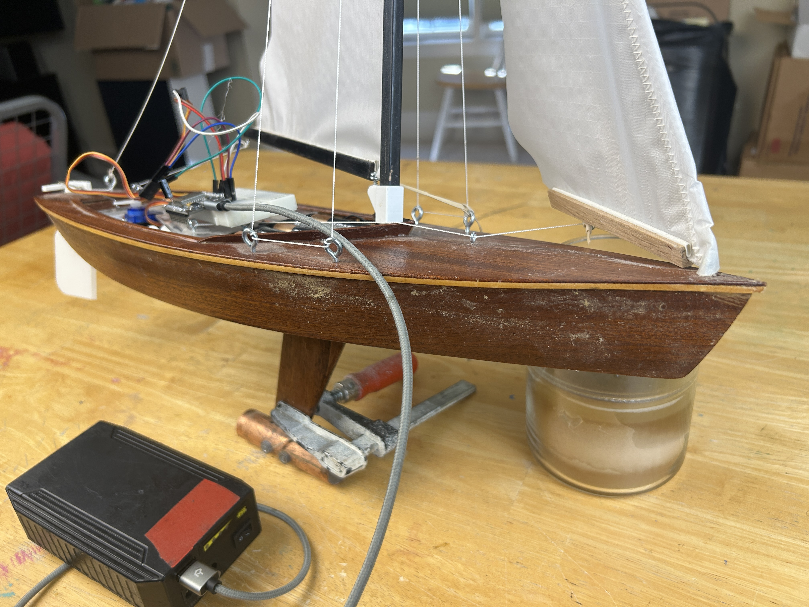
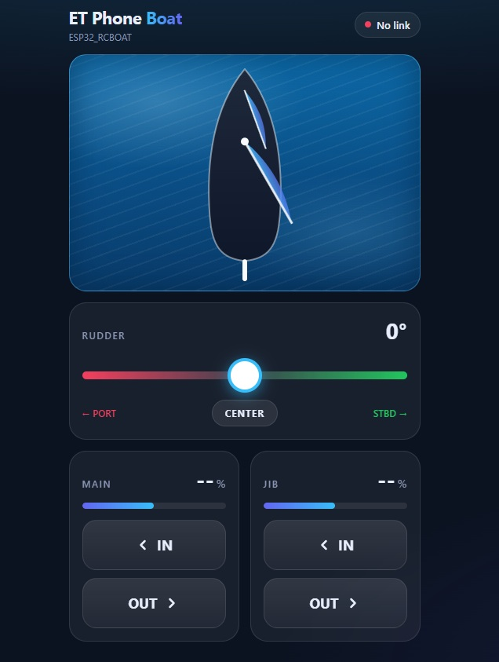
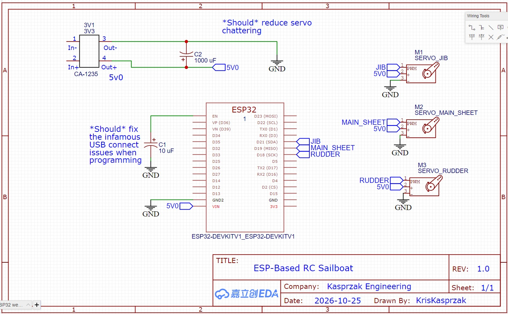

# ET Phone Boat: ESP32 RC Sailboat Controlled From Your Phone

A DIY radio-controlled sailboat you sail from your phone. An ESP32 creates its own WiFi
network and serves a web app that controls the **rudder**, **main sail** and **jib**.
You don't need an RC transmitter or an app store, and it runs without internet.

The boat is a 19" replica of a **Lightning sailboat** built from a Dumas kit, converted to RC
for around **$100** in parts.



> 🎬 YouTube video https://youtu.be/pYyqOyXu2d4

---

## Features

- **Phone control from Safari or any browser.** Join the `ESP32_RCBOAT` WiFi network and go to `http://192.168.1.1`.
- **Modern, simple UI.** A rudder slider, hold-to-trim IN/OUT buttons for each sail, and a live top-down view of the boat.
- **AJAX + JSON.** Commands go to the ESP32 instantly, and the page polls servo positions every 200 ms.
- **Continuous or positional sail servos.** One `#define` switches between 360° winch servos and standard 180° servos.
- **Safety built in:**
  - Sails move **only while a button is held**, and stop if the phone goes quiet.
  - The rudder centers itself if the link is lost.
  - Late or out-of-order network messages can't restart a sail.

## Phone App



| Control | Action |
|---|---|
| **Rudder** | Slider from -45° (port) to +45° (starboard), plus a CENTER button |
| **Main** | Hold **IN** or **OUT** to trim. The sail stops when you let go |
| **Jib** | Hold **IN** or **OUT** to trim. The sail stops when you let go |

The status pill in the top right shows **Connected** or **No link**. Tip: in Safari, use
*Share → Add to Home Screen* to run the app full screen.

## Hardware

| Part | Notes |
|---|---|
| ESP32 DevKit V1 | Any classic ESP32 dev board |
| 3 × SG-90 servos | Rudder (positional). Main and jib sheets (continuous rotation or positional) |
| CA-1235 buck converter | Powers the servos and ESP32 at 5 V from the battery pack |
| 4 × AA battery pack | Main power |
| 1000 µF capacitor | Across the 5 V servo supply, reduces servo chatter |
| 10 µF capacitor | Between EN and GND, fixes auto-reset problems when programming over USB |
| Breadboard + jumpers | Or solder it all once it works |

## Wiring



| Servo | ESP32 GPIO |
|---|---|
| Rudder | 18 |
| Main sheet | 19 |
| Jib | 21 |

All servo V+ wires go to the **5 V supply, not the ESP32's 3.3 V pin**. All grounds are connected together.

## Software Setup

1. Install the **ESP32 board package** in the Arduino IDE (*Boards Manager → "esp32" by Espressif*).
2. Install the libraries:
   - **ArduinoJson** 7.x by Benoit Blanchon, from the Library Manager
   - **ESP32_Servo**, the servo library with `PositionalServo` and `ContinuousServo` classes. Copy it into your Arduino `libraries` folder.
3. Open `ETPhoneBoat.ino`, select **ESP32 Dev Module** and upload.
4. On your phone, join the WiFi network **ESP32_RCBOAT** (open, no password).
5. Open Safari and go to **http://192.168.1.1**.

> iPhones may warn "No Internet Connection" on this network. That's expected. Stay connected and the page will load.

## Configuration

All settings are `#define`s at the top of `ETPhoneBoat.ino`:

| Setting | Default | What it does |
|---|---|---|
| `AP_SSID` / `AP_PASS` | `ESP32_RCBOAT` / `""` | WiFi network name. Set a password of 8 or more characters to stop others from taking the helm |
| `SAIL_CONTINUOUS` | `1` | `1` = 360° continuous servos (winches), `0` = standard 180° servos |
| `SAIL_SPEED_PCT` | `60` | Winch speed while a button is held |
| `MAIN_REVERSED` / `JIB_REVERSED` | `false` | Flip if IN lets the sail out |
| `MAIN_NEUTRAL_US` / `JIB_NEUTRAL_US` | `1500` | Adjust a few µs if a stopped winch creeps |
| `SAIL_TRAVEL_MS` | `4000` | Time from fully in to fully out, used for the sail % estimate |
| `RUDDER_CENTER` / `RUDDER_MAX_DEFLECT` | `90` / `45` | Rudder trim and travel |
| `RUDDER_REVERSED` | `false` | Flip if the boat turns the wrong way |
| `SAIL_HOLD_TIMEOUT` | `600` ms | Stop a sail if the held-button signal stops |
| `LINK_TIMEOUT` | `3000` ms | Center the rudder if the phone goes silent |

## How It Works

```
 Phone (Safari)                                    ESP32
 ──────────────                                    ─────
 rudder slider ──── PUT /RUDDER?VALUE=-12 ───────▶ UpdateRudder()  → rudder servo
 hold IN/OUT  ───── PUT /MAIN?DIR=IN&ID=n ───────▶ ProcessSail()   → main winch
              ───── PUT /JIB?DIR=OUT&ID=n ───────▶ ProcessSail()   → jib winch
 every 200 ms ───── PUT /json ───────────────────▶ SendJSON()
              ◀──── {"R":-12,"M":45,"J":60} ───────
```

- The whole web page (HTML, CSS and JavaScript) is stored in `BoatPage.h` as one raw string, so there's no file system to upload.
- While a sail button is held, the page repeats the command every 200 ms. Releasing sends STOP. Each press carries an ID, so a delayed repeat can't restart a sail after it has stopped.

## Files

| File | Description |
|---|---|
| `ETPhoneBoat.ino` | ESP32 sketch: access point, web server, servo control, safety timeouts |
| `BoatPage.h` | The phone web app (HTML/CSS/JS) |
| `Images/` | Photos, phone UI screenshot and wiring schematic |

## Beyond Boats

The same ESP32 + phone + servo setup works for RC planes, remote monitoring stations,
animatronic Halloween props and more. **Dream it, build it!** If you build something with it,
tell us about it in the YouTube comments once the video is up.

## License

MIT License. Code written by Kris Kasprzak.
